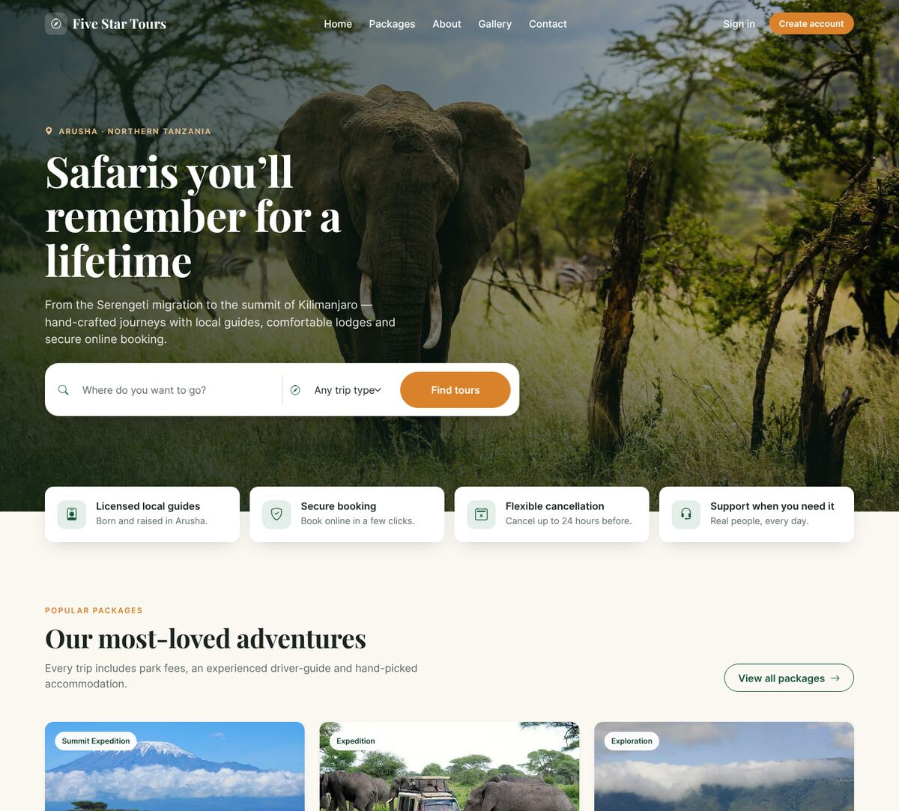
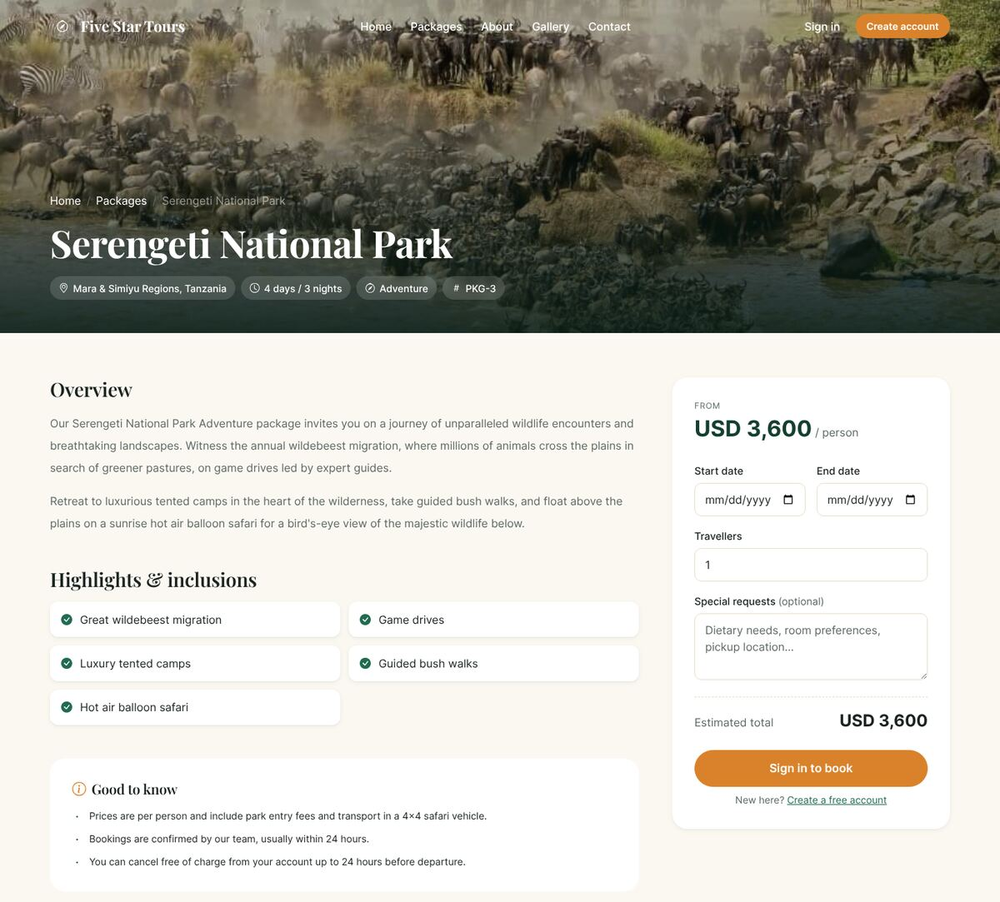
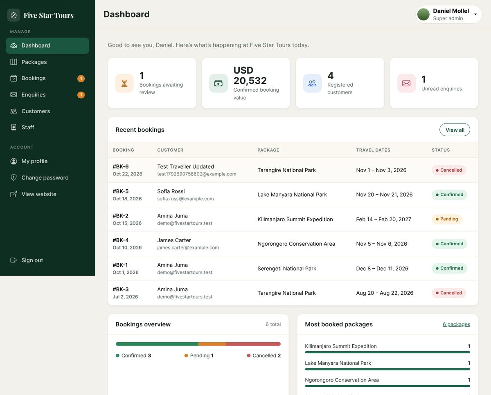

# Five Star Tours — Tourism Booking System

A full-stack tour booking platform for an Arusha-based safari company. Customers browse and book tour packages online; staff manage packages, bookings, enquiries, customers and team accounts from an admin portal.

Built with **PHP 8 + MySQL/MariaDB** (no framework), **Bootstrap 5.3** and vanilla JavaScript. It runs with Docker, XAMPP or on any PHP host.

| Website | Package details |
|---|---|
|  |  |
| **Admin dashboard** | **Mobile** |
|  |  |

---

## Features

**Customers**
- Browse, search, filter (by trip type) and sort tour packages
- Package pages with highlights, live price estimate and booking request form
- Accounts: register (with live email-availability check), sign in, profile, change password
- Secure password reset via one-time, expiring email link
- "My bookings": track status (pending / confirmed / cancelled) and cancel up to 24 h before departure
- Contact form that lands in the staff enquiries inbox

**Staff portal (`/admin`)**
- Dashboard: pending bookings, confirmed revenue, customers, unread enquiries, booking breakdown, top packages
- Packages: create, edit, delete (protected when bookings exist), image upload with preview
- Bookings: filter by status, search, confirm or cancel
- Enquiries inbox with reply-by-email and read/unread status
- Customer directory with booking counts
- Staff management with roles — **Super admin**, **Admin**, **Staff** — activate/deactivate, reset passwords
- Own profile with photo upload, change password

## Security

- **Passwords** hashed with bcrypt (`password_hash`); legacy MD5 hashes are upgraded automatically on next login
- **CSRF tokens** on every form and state-changing request; logout is POST-only
- **SQL injection** prevented with prepared statements everywhere (PDO, native prepares)
- **XSS** prevented by escaping all output (`e()` helper)
- **Sessions** hardened: HttpOnly + SameSite cookies, strict mode, ID regenerated on login
- **Uploads** validated by real MIME type, renamed to random names, script execution disabled in `uploads/`
- **Access control**: role checks on the server for every admin action; customers can only see and cancel their own bookings
- **Password reset** tokens are random, single-use, expire after 1 hour and only their SHA-256 hash is stored; responses don't reveal whether an email is registered
- **Hardening**: security headers (`X-Frame-Options`, `nosniff`, `Referrer-Policy`); `.htaccess` blocks `includes/`, `database/`, `.env` and other internal files; errors are logged, not shown, outside debug mode

---

## Run it locally

### Option A — Docker (recommended)

Requires [Docker Desktop](https://www.docker.com/products/docker-desktop/).

```bash
git clone https://github.com/eddiecontra/tourism-system.git
cd tourism-system
docker compose up -d
```

| What | URL |
|---|---|
| Website | http://localhost:8080 |
| Staff portal | http://localhost:8080/admin |
| phpMyAdmin | http://localhost:8081 |

The database is created and filled with demo data automatically on first start. To reset it to a clean state: `docker compose down -v && docker compose up -d`.

### Option B — XAMPP

Requires XAMPP with **PHP 8.1 or newer**.

1. Copy the project folder into `C:\xampp\htdocs\tms` (or `/Applications/XAMPP/htdocs/tms`).
2. Start **Apache** and **MySQL** in the XAMPP control panel.
3. Open http://localhost/phpmyadmin, create a database named **`tourism`** and import **`database/tourism.sql`**.
   *If you already have an old `tourism` database from the previous version, drop it first — the schema has changed.*
4. Visit http://localhost/tms.

No configuration is needed: without a `.env` file the app uses XAMPP's defaults (`root`, empty password).

### Option C — PHP's built-in server

With PHP 8.1+ and an existing MySQL/MariaDB server:

```bash
mysql -u root -p -e "CREATE DATABASE tourism CHARACTER SET utf8mb4"
mysql -u root -p tourism < database/tourism.sql
cp .env.example .env        # then set DB_USER / DB_PASS
php -S localhost:8000
```

### Demo accounts

| Where | Login | Password | Role |
|---|---|---|---|
| Website | `demo@fivestartours.test` | `Demo@1234` | Customer |
| Staff portal | `admin` | `Admin@1234` | Super admin |
| Staff portal | `staff` | `Staff@1234` | Staff |

Change these before putting the site online.

> **Password reset without a mail server:** when `APP_ENV=local` and `MAIL_ENABLED=false` (the default), the reset link is shown on screen after you submit the form, so the full flow can be demonstrated locally.

---

## Share a live demo link

To let someone open your locally running copy from anywhere (for example, during an interview), start a free temporary tunnel while the site is running:

```bash
# Cloudflare (no account needed) — https://developers.cloudflare.com/cloudflare-one/connections/connect-networks/downloads/
cloudflared tunnel --url http://localhost:8080      # use http://localhost/tms for XAMPP

# or ngrok — https://ngrok.com/download
ngrok http 8080
```

The command prints a public `https://…` URL that works until you stop it. While `APP_ENV=local`, the admin sign-in page displays the demo credentials, so anyone with the link can sign in — fine for a short demo, but change the passwords for anything longer.

---

## Configuration

Copy `.env.example` to `.env` to override settings. Real environment variables (e.g. from Docker or a hosting panel) take precedence.

| Variable | Default | Purpose |
|---|---|---|
| `APP_ENV` | `local` | `production` hides demo hints and dev-only reset links |
| `APP_DEBUG` | `false` | Show PHP errors in the browser (never enable in production) |
| `APP_URL` | auto | Public base URL used in emails |
| `DB_HOST` / `DB_PORT` / `DB_NAME` / `DB_USER` / `DB_PASS` | XAMPP defaults | Database connection |
| `MAIL_ENABLED` / `MAIL_FROM` | `false` | Send password-reset emails with PHP `mail()` |
| `COMPANY_ADDRESS` / `COMPANY_PHONE` / `COMPANY_EMAIL` | demo values | Contact details shown on the site |

## Deploying

Any host with PHP 8.1+, MySQL/MariaDB and Apache works:

- **Shared hosting** (Hostinger, Namecheap, InfinityFree…): upload the files, import `database/tourism.sql` with phpMyAdmin, create a `.env` with the database credentials and `APP_ENV=production`.
- **Docker hosts** (Railway, Render, Fly.io, a VPS): build the included `Dockerfile` and set the `DB_*` and `APP_*` variables; attach a managed MySQL database.

---

## Project structure

```
├── index.php, packages.php, package_details.php   Public pages
├── login.php, register.php, forgot_password.php, reset_password.php, logout.php
├── tour_history.php, profile.php, change_password.php   Customer account
├── contact.php, check_availability.php             Form handler / JSON endpoint
├── includes/
│   ├── bootstrap.php     Config, session, security headers, DB connection, CSRF guard
│   ├── helpers.php       Escaping, flash messages, auth, CSRF, uploads, mail
│   ├── env.php           .env loader
│   ├── header.php / footer.php / partials/   Shared layout
├── admin/
│   ├── includes/auth.php      Staff authentication & roles
│   ├── includes/layout_*.php  Admin layout
│   └── dashboard.php, manage_*.php, package_form.php, staff*.php, profile.php …
├── assets/               CSS, JS, fonts, images, vendored Bootstrap & icons
├── uploads/              Package and profile images (script execution disabled)
├── database/tourism.sql  Schema + demo data
├── Dockerfile, docker-compose.yml, docker/
└── .github/workflows/ci.yml   Lint on PHP 8.1–8.3 + smoke test against MariaDB
```

## Database

| Table | Purpose |
|---|---|
| `tbltourpackages` | Tour packages (name, type, location, duration, price, highlights, description, image) |
| `tblbooking` | Booking requests: package, customer email, dates, travellers, status (0 pending, 1 confirmed, 2 cancelled) |
| `tblusers` | Customer accounts |
| `tbladmin` | Staff accounts and roles |
| `tblenquiry` | Contact-form messages |
| `tblpassword_resets` | Hashed, expiring password-reset tokens |

---

For further assistance contact me at emmanueledmund00@gmail.com.
